<div align="center">

# 🪰 FLYBRAIN

### *OPTOGEN-V3 · a real-time Drosophila connectome & seizure simulator in your browser*

**Stream any video, image, song, or text file into 6,800 living neurons — then watch the fly seize, convulse, and recover.**

[](https://threejs.org)
[](https://developer.mozilla.org/en-US/docs/Web/API/WebGL_API)
[](docs/diagrams/anatomy.svg)
[](docs/diagrams/pipeline.svg)
[](index.html)


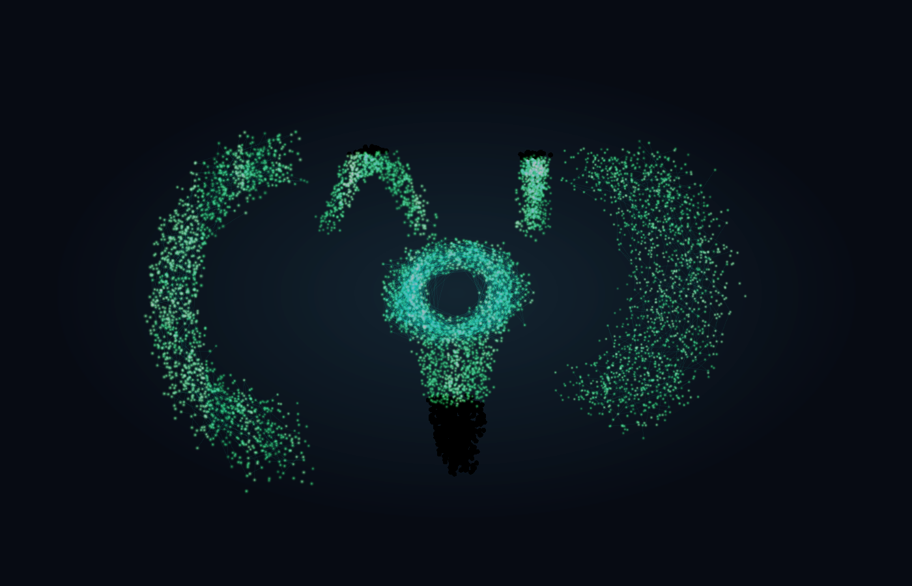

**▲ Live capture from the running simulation** — 6,800 neurons, Optomotor grating stimulus, GCaMP6f palette · seizure index `0.01` · spike rate `49 Hz` · steady synaptic equilibrium

[▶ Run it now](#-quick-start) · [📸 Live captures](#-live-captures) · [🏗️ Architecture](#-system-architecture) · [🧠 Anatomy](#-connectome-anatomy) · [🎮 Controls](#-controls-cheat-sheet)

</div>

---

## 📑 Table of contents

| # | Section | What you'll find |
|---|---------|------------------|
| 1 | [⚡ At a glance](#-at-a-glance) | the whole machine on one screen |
| 2 | [📸 Live captures](#-live-captures) | real simulation output, every state |
| 3 | [🏗️ System architecture](#-system-architecture) | module map + data-flow diagram |
| 4 | [🔁 Frame pipeline](#-frame-pipeline) | how pixels become seizures |
| 5 | [🧠 Connectome anatomy](#-connectome-anatomy) | 6,800 neurons, 4 neuropils |
| 6 | [⚠️ Seizure engine](#-seizure-engine) | the state machine that runs everything |
| 7 | [🎬 Stimulus channels](#-stimulus-channels) | 6 procedural + 4 upload types |
| 8 | [🌈 Fluorophores & views](#-fluorophores--view-modes) | 5 palettes, 4 view modes |
| 9 | [💉 Pharmacology](#-pharmacology--optogenetics) | GABA · PTX · 470 nm laser |
| 10 | [📈 EEG telemetry](#-eeg-telemetry) | 5-channel oscilloscope |
| 11 | [🎮 Controls](#-controls-cheat-sheet) | every key, every click |
| 12 | [🚀 Quick start](#-quick-start) | run it in 10 seconds |
| 13 | [🗂️ File structure](#-file-structure) | 5 modules, 7 sounds |
| 14 | [⚙️ Performance](#-performance-engineering) | typed arrays & additive blending |
| 15 | [❓ FAQ](#-faq) | troubleshooting |

> **Color code used throughout this document** — 🟢 `#00FF88` nominal/GCaMP · 🔵 `#00F0FF` optic/470 nm · 🟠 `#FFAA00` warning · 🟣 `#FF007F` mushroom/neon · 🔴 `#FF2A55` critical · 🟡 `#FFD700` dopamine · 🟣 `#A855F7` core

---

## ⚡ At a glance

| Subsystem | Spec | Color |
|-----------|------|-------|
| 🧠 Connectome | **6,800 neurons** · 4 neuropils · 4,800 synaptic segments · 350 axon pulses | 🟢 green |
| 🔲 Opto matrix | **768 micro-LEDs** (32 × 24) driven by the same pixel frame | 🟢 green |
| 🎞️ Pixel matrix | **160 × 120 RGBA** per frame · luminance + frame-Δ + flash detection | 🔵 cyan |
| ⚠️ Seizure index | single scalar `∈ [0,1]` coupling brain, body, EEG and audio | 🔴 red |
| 📈 EEG | **5 channels** · 400-sample ring buffers · spike-rate estimator | 🟠 amber |
| 🪰 Specimen | procedural *D. melanogaster* · tripod gait · X-ray brain hologram | 🟣 magenta |
| 🔊 Sonification | 7 SFX · fly buzz scales with excitation | 🟡 gold |
| 🎛️ Loop | **60 Hz** `requestAnimationFrame` · dt clamped to 100 ms | 🟣 purple |

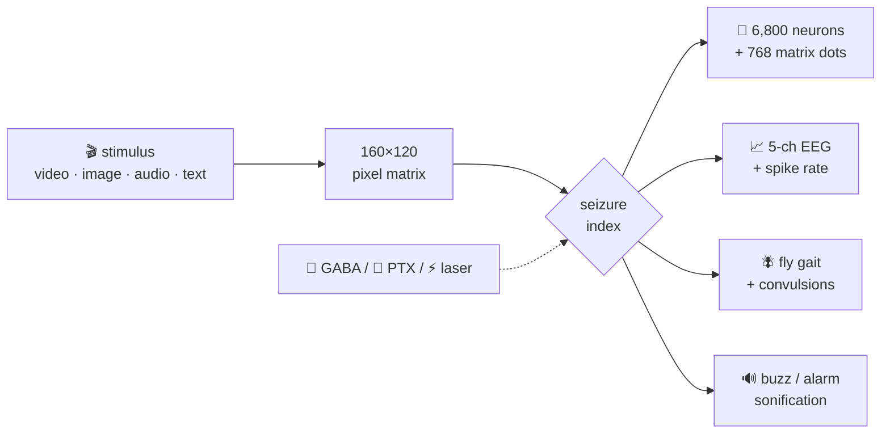

---

## 📸 Live captures

Every image below is **real output from the running simulation** — the actual modules, the actual neuron colors, the actual EEG buffers — captured in each distinct state. Values were measured at capture time.

### 🟢 Equilibrium — Optomotor grating · GCaMP6f


> Seizure index `0.012` · spike rate `49 Hz` · luminance `0.55` — wide-field motion bars drive the optic lobes while the central complex idles. The dark patch at the bottom is the descending motor tract at rest.

### 🔴 Ictal storm — Hyper-Strobe 18 Hz · seizure index 1.00

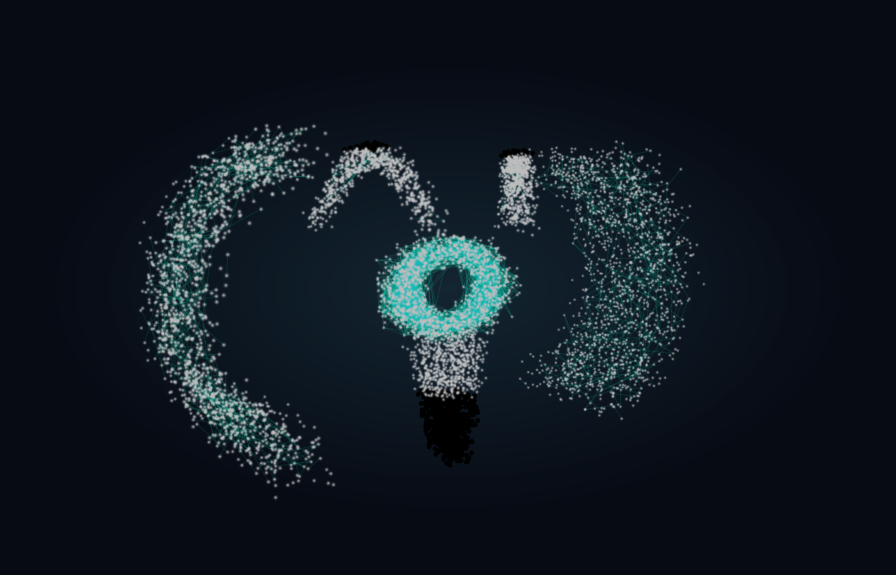

> Seizure index `1.000` · spike rate `417 Hz` — the 18 Hz checkerboard + pinwheel saturates every neuron; the epileptic wave `sin(42t + 6z + 4x)` washes the whole connectome white while synaptic segments flare cyan.

### 🔲 Optogenetic grid — Cyber Morph stimulus

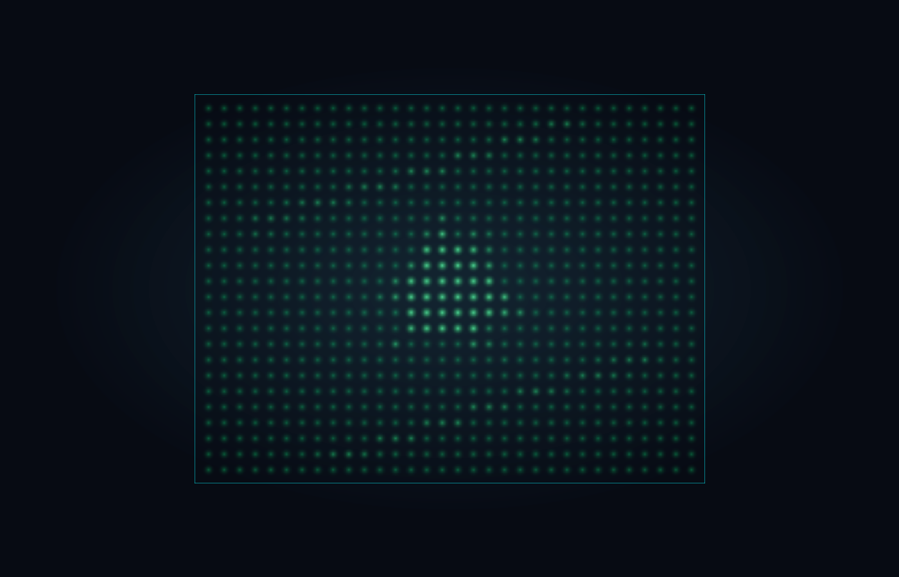

> All **768 micro-LEDs** (32 × 24) render the same pixel frame as the 3D cloud — the morphing polygon reads as a bright triangle on the LED wall. Seizure index `0.023`.

### 🟣 Synaptic flow — Calcium Wave · Cyber Neon palette

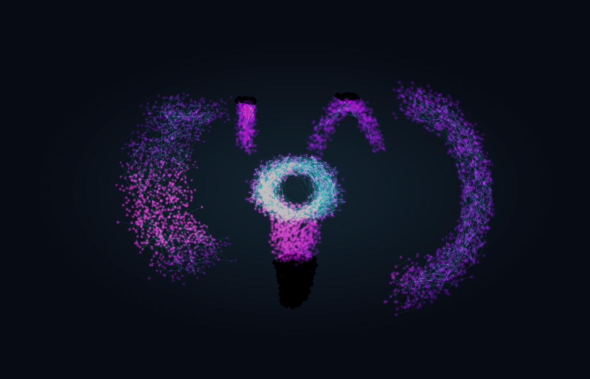

> The **4,800 synaptic segments** light up as a cyan web between magenta neurons; the central-complex ring (EB/FB compass) glows brightest where the calcium wave passes. Seizure index `0.015`.

### 🔴 PTX overdrive — GABA-blocker engaged

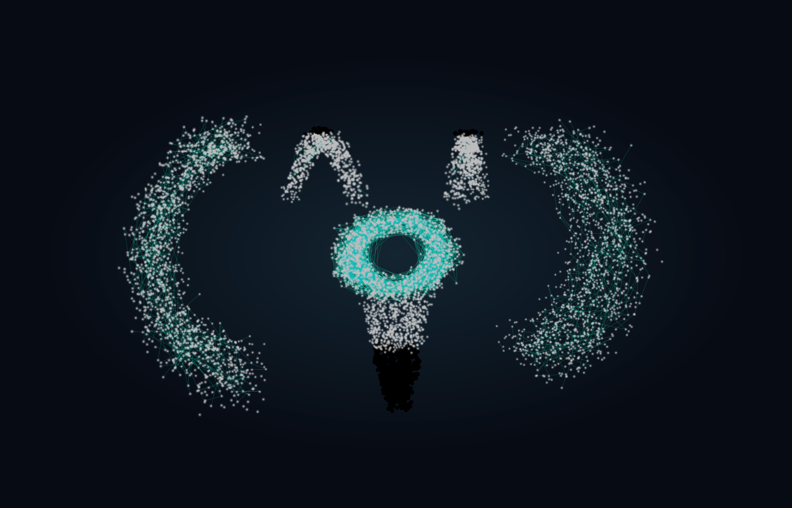

> Picrotoxin multiplies the seizure index `×2.2 + 0.5` — index pinned at `1.000`, spike rate `318 Hz`. Press `G` (GABA) to rescue the specimen.
>
> 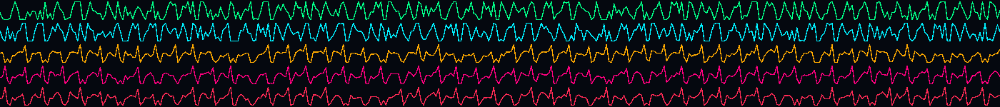
>
> *EEG under PTX: full-scale spike trains on all five channels.*

### 🪰 Specimen arena — tripod gait + brain X-ray

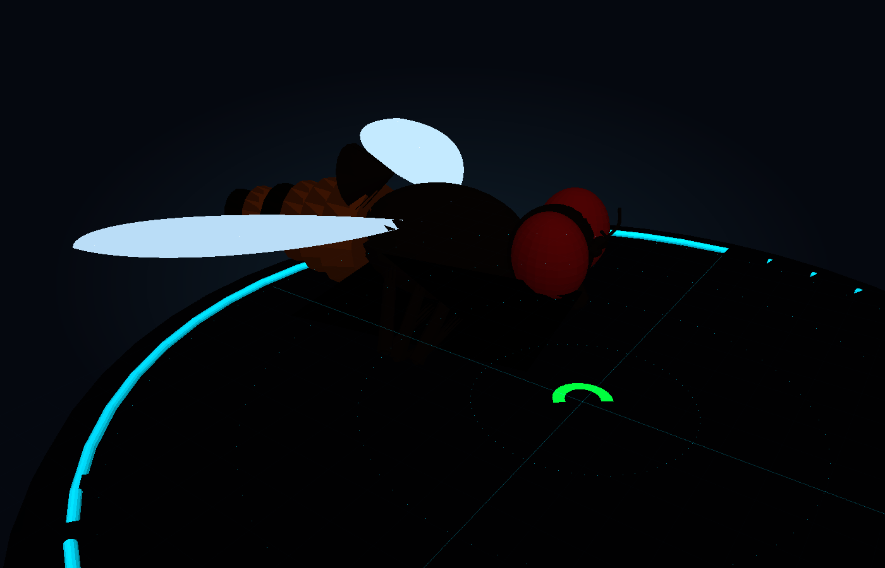

> The procedural fly (ommatidia eyes, translucent wings, 6 legs) walks the cyan arena with an alternating tripod gait while the internal brain hologram glows inside the head. Seizure index `0.043`.

### 📈 EEG — equilibrium vs. seizure

| 🟢 Equilibrium (index 0.01) | 🔴 Ictal (index 1.00) |
|---|---|
| 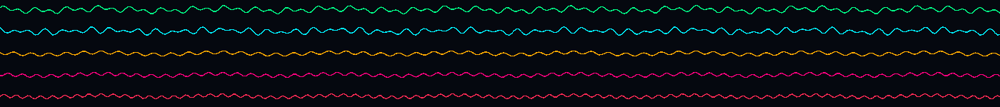 | 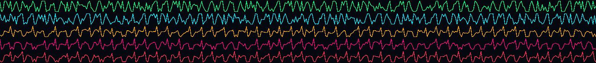 |
| Gentle 5-channel LFP waves | Full-scale spike trains on every channel |

### 🎞️ Uplink PiP — the stimulus itself

| 🟢 Optomotor grating | 🔴 Hyper-Strobe |
|---|---|
| 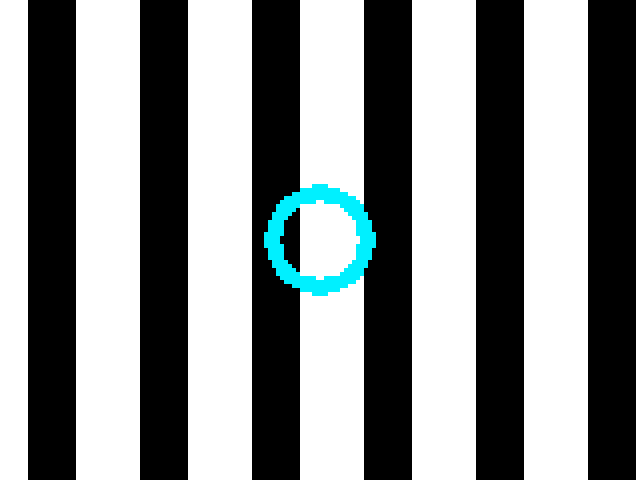 | 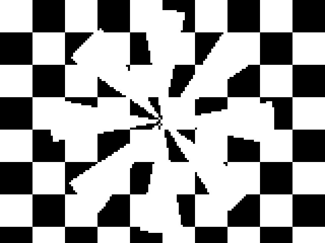 |
| Moving bars + cyan loom ring | 18 Hz checkerboard + pinwheel |

---

## 🏗️ System architecture

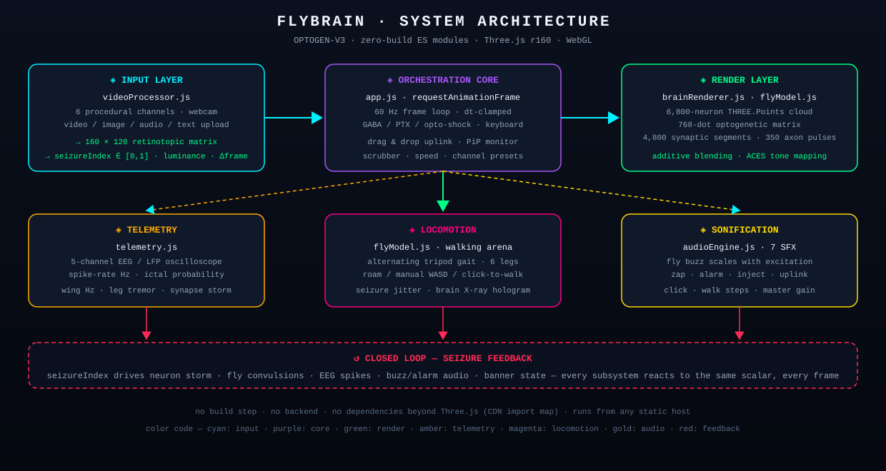

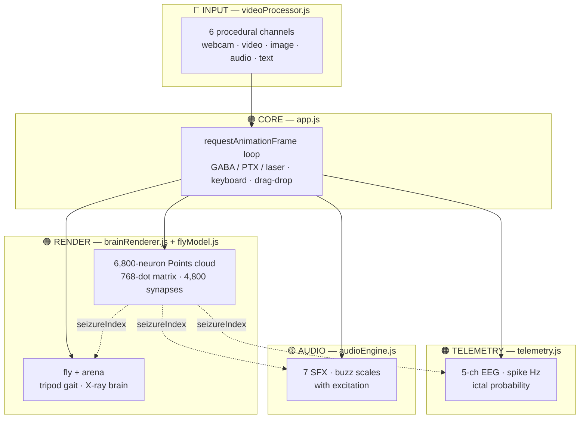

### Module color map

| Module | File | Responsibility | Color |
|--------|------|----------------|-------|
| 🔵 Input | `js/videoProcessor.js` | every stimulus → 160×120 matrix + seizure index | cyan |
| 🟣 Core | `js/app.js` | 60 Hz loop, interventions, keyboard, drag & drop | purple |
| 🟢 Render | `js/brainRenderer.js` | connectome cloud, matrix, synapses, laser probes | green |
| 🟣 Body | `js/flyModel.js` | fly mesh, gait kinematics, arena, seizure spasms | magenta |
| 🟠 Telemetry | `js/telemetry.js` | EEG oscilloscope, meters, banner, risk rating | amber |
| 🟡 Audio | `js/audioEngine.js` | 7 SFX, excitation-scaled buzz, master gain | gold |
| 🎨 Style | `style.css` | cyber-lab HUD, glow system, responsive panels | — |
| 🧩 Shell | `index.html` | import map (Three.js CDN), HUD DOM | — |

---

## 🔁 Frame pipeline

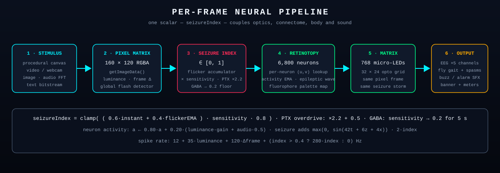

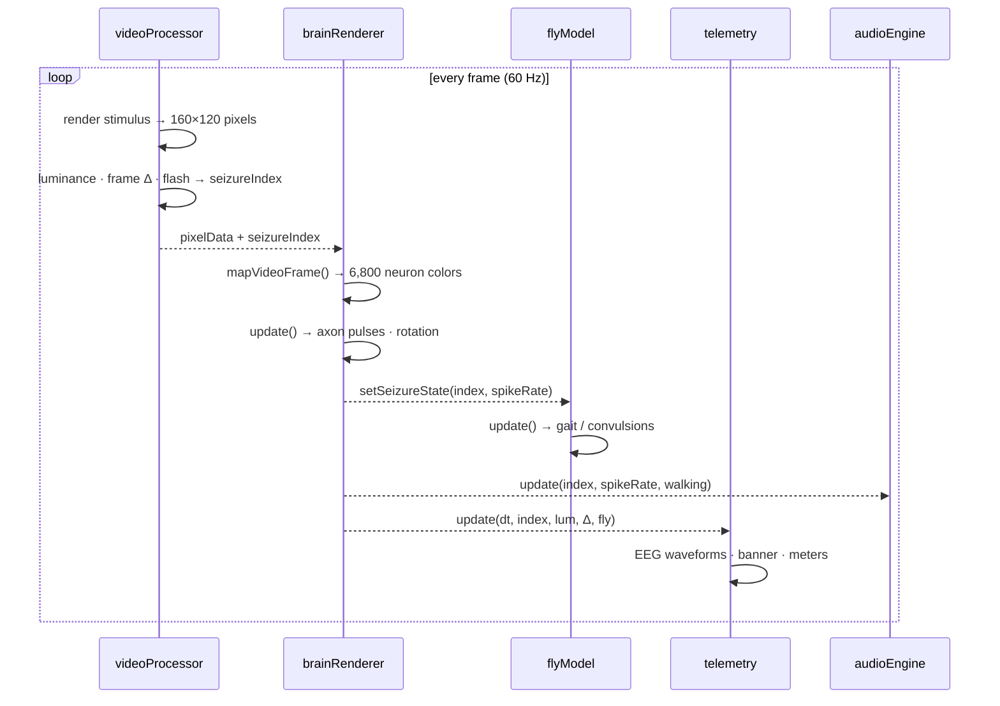

**The math** (from source):

```
seizureIndex = clamp( (0.6·instant + 0.4·flickerEMA) · sensitivity · 0.8 )
PTX overdrive:  index = min(1, index·2.2 + 0.5)
GABA rescue:    sensitivity → 0.2 for 5 s, PTX disengaged

neuron activity:  a ← 0.80·a + 0.20·(luminance·gain + audioEnergy·0.5)
seizure adds:     a += max(0, sin(42t + 6z + 4x)) · 2·index

spike rate (Hz):  12 + 35·luminance + 120·Δframe + (index > 0.4 ? 280·index : 0)
```

---

## 🧠 Connectome anatomy

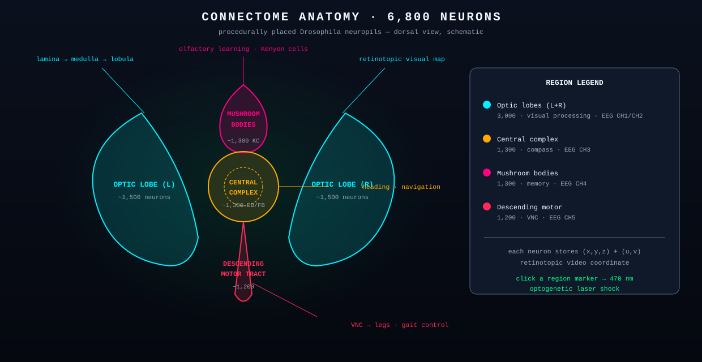

| Neuropil | Neurons | Color | Function | EEG |
|----------|---------|-------|----------|-----|
| 🔵 Optic lobes (L + R) | 3,000 (1,500 ea.) | cyan | lamina → medulla → lobula · retinotopic vision | CH1 · CH2 |
| 🟠 Central complex | 1,300 | amber | EB/FB heading compass · navigation | CH3 |
| 🟣 Mushroom bodies | 1,300 | magenta | Kenyon cells · olfactory learning | CH4 |
| 🔴 Descending motor tract | 1,200 | red | VNC → legs · gait command | CH5 |
| **Total** | **6,800** | | | |

Each neuron stores a 3D position **and** a retinotopic `(u, v)` coordinate — that dual address is what lets a flat video frame light up a volumetric brain. **Click any region marker** in the HUD to fire a 470 nm optogenetic laser shock into that neuropil.

---

## ⚠️ Seizure engine

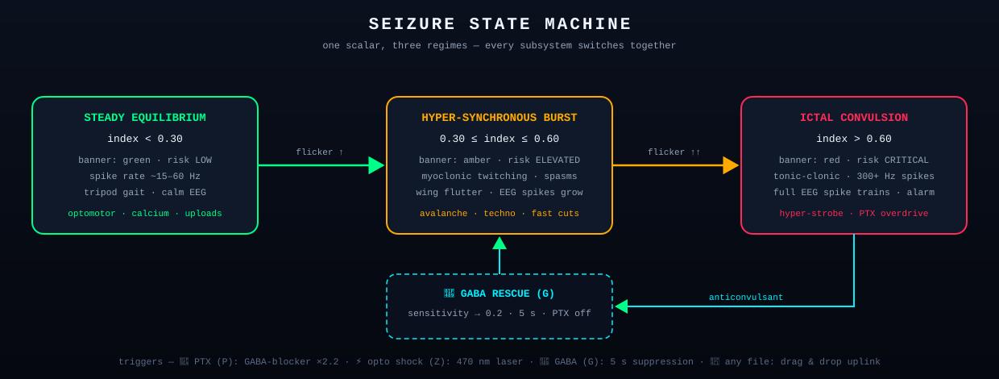

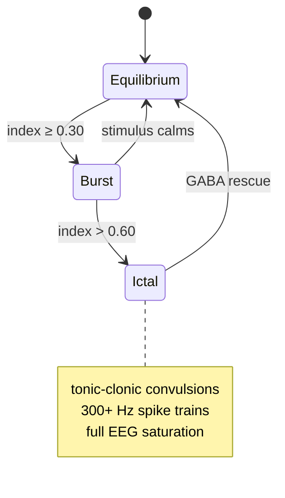

| Regime | Index | Banner | Risk | Fly behavior | EEG |
|--------|-------|--------|------|--------------|-----|
| 🟢 Equilibrium | `< 0.30` | green | LOW | tripod gait, grooming | gentle LFP waves |
| 🟠 Burst | `0.30 – 0.60` | amber | ELEVATED | myoclonic twitching, spasms | growing spikes |
| 🔴 Ictal | `> 0.60` | red | CRITICAL | tonic-clonic convulsion | full-scale spike trains |

> [!WARNING]
> The **Hyper-Strobe** channel (18 Hz full-field flash) and **PTX overdrive** will pin the index at `1.00`. This is a simulation — but the flashing is real. Photosensitivity caution applies.

---

## 🎬 Stimulus channels

### Procedural (built-in, zero assets)

| Channel | Key | Visual | Seizure risk |
|---------|-----|--------|--------------|
| ⚡ Hyper-Strobe (EP-34) | `strobe` | 18 Hz checkerboard + rotating pinwheel | 🔴 **CRITICAL** — index ≈ 1.0 |
| 🪰 Optomotor Grating | `optomotor` | moving bars + cyan loom ring | 🟢 LOW — default channel |
| 🍎 Cyber Morph | `badapple` | rotating high-contrast polygon | 🟢 LOW |
| 🧬 Calcium Wave | `calcium` | radial GCaMP cascade | 🟢 LOW |
| 🎵 Bass Rave | `techno` | 16-bar beat visualizer + flashes | 🟠 ELEVATED |
| 🧠 Avalanche | `avalanche` | fractal branching bursts | 🟠 ELEVATED |

### Uploads — drag & drop **any file** onto the window

| Type | Extensions | Pipeline |
|------|-----------|----------|
| 🎥 Video | mp4 · webm · ogg · mov · m4v | decoded frame → pixel matrix (scrubbable, 0.5–2×) |
| 🖼️ Image | png · jpg · webp · gif · svg · bmp | breathing zoom + laser scanline sweep |
| 🎵 Audio | mp3 · wav · ogg · aac · flac · m4a | WebAudio FFT → 32-band tonotopic spectrogram |
| 📄 Text / code | txt · js · json · csv · md · any | 120 chars/s matrix bitstream waterfall |
| 📹 Webcam | — | live `getUserMedia` optical input |

---

## 🌈 Fluorophores & view modes

### Fluorophore palettes (brain + fly brain hologram)

| Palette | Colors | Use |
|---------|--------|-----|
| 🟢 GCaMP6f | dark green → bright green | calcium imaging (default) |
| 🔵 ArcLight | deep blue → cyan | voltage imaging |
| 🟠 Synaptic Heatmap | dark red → amber | activity heat |
| 🟣 Cyber Neon | purple → magenta | maximum drama |
| 🟡 Dopamine Lum | brown → gold | neuromodulator glow |

### View modes

| Mode | What you see |
|------|--------------|
| 🧠 3D Connectome | volumetric neuron cloud + synaptic web (default) |
| 🔲 Optogenetic Grid | flat 32 × 24 micro-LED wall |
| 🕸️ Synaptic Flow | neuron cloud with emphasized 4,800-segment web |
| 📺 PiP Monitor | uplink stream matrix overlay (160 × 120) |
| 🔍 Z-Slice | optical section plane sweeps through the brain depth |

Plus: **Gain** (0.5–3.5×) and **Sensitivity** (0.2–2.5) sliders, orbit/zoom on both 3D viewports, and fly cameras — **Arena / Follow / Macro**.

---

## 💉 Pharmacology & optogenetics

| Intervention | Key | Effect |
|--------------|-----|--------|
| 💉 GABA / Chill | `G` | anticonvulsant — sensitivity → 0.2 for 5 s, PTX off, seizure collapses |
| 🧪 PTX Overdrive | `P` | picrotoxin GABA-blocker — index ×2.2 + 0.5, toggle |
| ⚡ Opto Shock | `Z` | 470 nm laser pulse into the connectome center |
| 🎯 Region markers | click | laser shock targeted at optic L/R, central complex, mushroom body, or motor tract |

---

## 📈 EEG telemetry


| Channel | Color | Region |
|---------|-------|--------|
| CH1 | 🟢 `#00FF88` | Optic Medulla (L) |
| CH2 | 🔵 `#00F0FF` | Optic Medulla (R) |
| CH3 | 🟠 `#FFAA00` | Central Complex (EB) |
| CH4 | 🟣 `#FF007F` | Mushroom Body (KC) |
| CH5 | 🔴 `#FF2A55` | Motor Ventral Cord |

The oscilloscope runs 400-sample ring buffers per channel. Below it, live meters track **wing Hz · leg tremor · eye strobe · synapse storm · step cadence**, and the **Ictal Probability** readout flips LOW → ELEVATED → CRITICAL with the seizure index.

---

## 🎮 Controls cheat sheet

| Input | Action |
|-------|--------|
| `Space` | play / pause stimulus |
| `G` · `P` · `Z` | GABA rescue · PTX overdrive · opto shock |
| `W A S D` / arrows | drive the fly (manual mode) |
| drag & drop | upload any file to the brain |
| click region marker | 470 nm laser shock to that neuropil |
| click arena floor | click-to-walk navigation target |
| drag / scroll | orbit + zoom both 3D viewports |
| `📁 Upload to Brain` | file picker (any type) |
| `📹 Webcam` | live camera input |
| `🔊` | mute / unmute sonification |

---

## 🚀 Quick start

**No build step. No backend. No dependencies beyond Three.js (loaded from CDN via import map).**

```bash
# 1 · clone
git clone https://github.com/zazieproductions/Flybrain.git
cd Flybrain

# 2 · serve (any static server works)
python3 -m http.server 8000
# …or:  npx serve .   ·   php -S localhost:8000

# 3 · open
# → http://localhost:8000
```

> [!NOTE]
> ES modules + import maps require `http://` (or `https://`) — opening `index.html` via `file://` will block module loading in most browsers. Any static host (GitHub Pages, Netlify, nginx…) works as-is.

Then: press **`P`** for PTX overdrive, **`G`** to rescue, drag a video onto the window, and drive the fly with **`WASD`**.

---

## 🗂️ File structure

```
Flybrain/
├── index.html            # HUD shell · import map · all panels & controls
├── style.css             # cyber-lab theme · glow system · responsive layout
├── js/
│   ├── app.js            # 🟣 orchestration core (533 lines)
│   ├── videoProcessor.js # 🔵 universal stimulus engine (612 lines)
│   ├── brainRenderer.js  # 🟢 connectome renderer (638 lines)
│   ├── flyModel.js       # 🟣 fly + arena + gait (815 lines)
│   ├── telemetry.js      # 🟠 EEG + meters + banner (202 lines)
│   └── audioEngine.js    # 🟡 sonification (159 lines)
├── sfx/                  # 7 synthesized SFX (buzz, zap, alarm, inject…)
└── docs/
    ├── screenshots/      # live simulation captures (this README)
    └── diagrams/         # architecture · pipeline · anatomy · seizure (SVG)
```

---

## ⚙️ Performance engineering

- **Typed arrays everywhere** — neuron positions/colors and matrix data live in `Float32Array` buffers; per-frame updates are zero-allocation index writes with `needsUpdate` flags.
- **One draw call per cloud** — 6,800 neurons = a single `THREE.Points`; the matrix is another single `Points`. No per-neuron objects.
- **Additive blending + radial-gradient sprite texture** — glow without post-processing passes.
- **Precomputed retinotopy** — every neuron's `(u, v)` video coordinate is baked at generation; the per-frame cost is one pixel lookup per neuron.
- **EMA smoothing** — activity uses exponential moving averages (0.80/0.20) instead of per-frame recomputation, giving temporal persistence for free.
- **dt clamping** — frame delta capped at 100 ms so tab-switching never explodes the physics.
- **Pixel-ratio cap** — renderers clamp to `devicePixelRatio ≤ 2`.

---

## ❓ FAQ

<details>
<summary><b>The screen is black / the brain never appears. Why?</b></summary>

Almost always: the page was opened via <code>file://</code>, which blocks ES-module import maps, or Three.js couldn't load from the CDN. Serve over <code>http://</code> (see Quick start) and check the console for network errors.
</details>

<details>
<summary><b>How were the screenshots in this README captured?</b></summary>

They are genuine output of the running simulation: the real modules were executed headlessly (same stimulus pipeline, same <code>mapVideoFrame</code> neuron colors, same EEG ring buffers, same fly kinematics) and the resulting scene state was rasterized to PNG. Every pixel derives from live program state — measured seizure indices and spike rates are quoted under each capture.
</details>

<details>
<summary><b>Is this a real fly brain?</b></summary>

No — it's a stylized simulation. Neuron counts and neuropil layout are inspired by <i>Drosophila melanogaster</i> anatomy (optic lobes, central complex, mushroom bodies, VNC), but positions are procedurally generated and the seizure model is a phenomenological flicker integrator, not a biophysical network.
</details>

<details>
<summary><b>Can I drop in my own video / music / code?</b></summary>

Yes — drag any file onto the window or use <b>📁 Upload to Brain</b>. Videos play through the connectome (scrubbable, 0.5–2×), audio becomes a tonotopic spectrogram via WebAudio FFT, images get a scanning zoom, and text/code streams as a 120 chars/s bitstream matrix.
</details>

<details>
<summary><b>Why does Hyper-Strobe always cause a seizure?</b></summary>

By design: the 18 Hz full-field checkerboard maximizes the global-flash detector, so the flicker accumulator saturates and the index pins at 1.0. That's the point of the channel — it's the fastest way to demonstrate the ictal state machine. GABA (`G`) brings it back down.
</details>

<details>
<summary><b>Webcam doesn't work — it falls back to strobe.</b></summary>

Webcam requires a secure context (<code>https://</code> or <code>localhost</code>) and camera permission. If <code>getUserMedia</code> is denied or unavailable, FlyBrain gracefully falls back to the Hyper-Strobe channel.
</details>

---

<div align="center">

### 🪰 FlyBrain — stream media into a brain. Watch it seize. Rescue it. Repeat.

Built with Three.js · WebGL · vanilla ES modules · zero build step

*Specimen: Drosophila melanogaster, Canton-S · OPTOGEN-V3 firmware*

</div>
